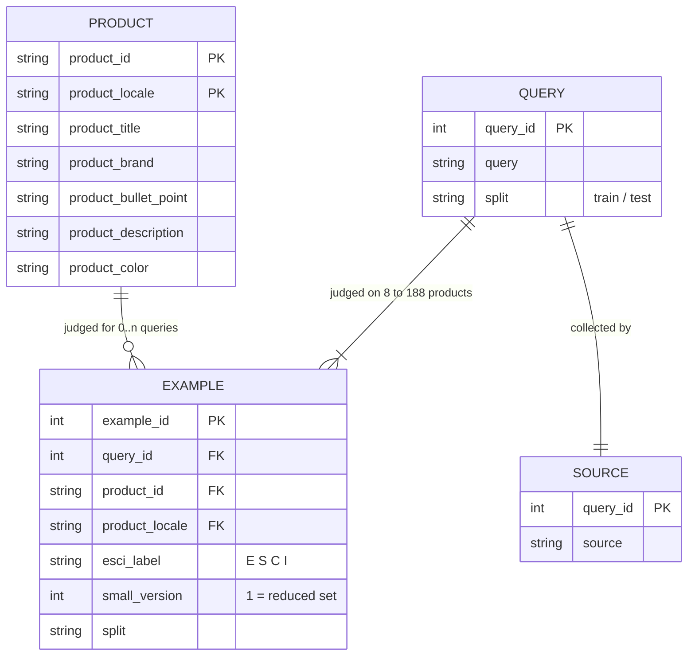
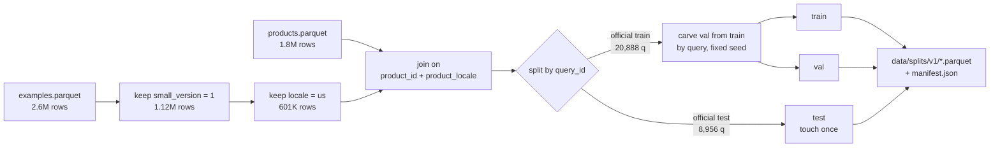

# Data: Amazon Shopping Queries (ESCI)

Source: [amazon-science/esci-data](https://github.com/amazon-science/esci-data), commit `7916cdf`. Checksums are in [SETUP.md](SETUP.md#data-is-not-in-git).
All numbers below come from running DuckDB on the raw files (2026-10-13). Unless noted, they cover the **reduced version** (`small_version = 1`), which is what we use.

---

## 1. The three files

| File | One row is… | Rows (whole file) |
|---|---|---|
| `shopping_queries_dataset_examples.parquet` | one **human judgment**: query + product + label | 2,621,288 |
| `shopping_queries_dataset_products.parquet` | one **product** in one locale | 1,814,924 |
| `shopping_queries_dataset_sources.csv` | one **query** and how it was collected | 130,652 |

There's no separate queries file. A query's text, `split`, and locale live on its examples rows.

## 2. How they relate

- **Join keys:** `examples → products` on **(`product_id`, `product_locale`)**, both columns. 11,567 product IDs exist in more than one locale, so joining on `product_id` alone duplicates rows.
- `examples → sources` on `query_id`.
- **Many-to-many:** a query has many judged products, and 124,674 products are judged for more than one query.
- Join coverage is complete: all 1,118,011 reduced examples find their product.
- Each query belongs to exactly one locale and exactly one split.

## 3. One real query, end to end

Query 1 is `!awnmower tires without rims` (`us`, train, source `negations`). It has 16 judged products, a few of which are shown here:

| esci_label | product_title (truncated) | brand |
|---|---|---|
| E | MaxAuto 2-Pack 13x5.00-6 2PLY Turf Mower Tractor Tire with Yellow Rim… | MaxAuto |
| E | Carlisle Turf Saver Lawn & Garden Tire - 15X6-6 A | Carlisle Paddles |
| S | Honda 44710-VG3-010 Front Wheels, (Set of 2) | Honda |
| C | Dr.Roc Tire Spoon Lever Dirt Bike Lawn Mower Motorcycle Tire Changing… | Dr.Roc |
| I | American Lawn Mower Company 1204-14 14-Inch 4-Blade Push Reel Lawn Mow… | American Lawn Mower Company |

This one query shows three of the problems below at once: a typo (`!awnmower`), a negation ("without rims"), and a product labelled Exact whose title says "with Yellow Rim". The labels are noisy.

## 4. Labels

| Label | Meaning | Gain (ESCI paper) | Reduced, all locales | `us` only |
|---|---|---|---|---|
| **E**xact | matches the whole query | 1.0 | 489,499 (43.8%) | 261,527 (43.5%) |
| **S**ubstitute | wrong in some detail but usable instead | 0.1 | 383,504 (34.3%) | 211,191 (35.1%) |
| **C**omplement | doesn't match, but goes with it (a charger for a phone) | 0.01 | 57,582 (5.2%) | 27,189 (4.5%) |
| **I**rrelevant | no match | 0 | 187,426 (16.8%) | 101,447 (16.9%) |

**Why this matters:**
- About 78% of the judged products are E or S. A random ordering of the candidates already scores well, so look at how much a model *beats* random, not the raw NDCG.
- C is rare. Any model that has to predict C directly will struggle.
- 48,299 of 48,300 queries have at least one E. The one exception is the "all-irrelevant" edge case the metric tests need to cover.

## 5. Key numbers

| | All locales | `us` |
|---|---|---|
| Queries | 48,300 | 29,844 |
| Judgments (rows) | 1,118,011 | 601,354 |
| Distinct judged products | 883,716 | 482,105 |
| Products in catalog file (whole file) | 1,814,924 | 1,215,854 |
| Train / test queries (official split) | 33,804 / 14,496 | 20,888 / 8,956 |
| Judged products per query (min / median / mean / max) | 8 / 16 / 23.1 / 188 | 8 / 16 / 20.1 / 188 |
| Query length in words (median) | — | 4 |

Locales: `us` 29,844 queries · `jp` 10,407 · `es` 8,049.

**Product fields: % missing or empty (whole products file)**

| Locale | title | brand | bullet_point | description | color | title words (median) |
|---|---|---|---|---|---|---|
| us | 0.0 | 5.9 | 14.7 | 46.9 | 33.4 | 15 |
| es | 0.0 | 4.6 | 14.2 | 45.5 | 38.5 | 18 |
| jp | 0.0 | 17.2 | 26.1 | 55.9 | 54.5 | 7* |

\* Japanese doesn't separate words with spaces, so whitespace word counts (and whitespace tokenizers in general) don't work for `jp`.

Takeaway: **title is the only field that is always present.** BM25 and embeddings should start from the title, then add brand and bullets. Description is missing about half the time.

**Query sources (reduced queries):** other 35,449 · negations 5,896 · parse_pattern 4,004 · behavioral 2,852 · nlqec 99. These are useful later for failure analysis, for example "do we do worse on negation queries?"

## 6. From raw files to our splits

- **Split by query, never by row.** If one query's products end up in both train and test, the model has effectively seen the test query, and the scores are inflated. The official split already follows this rule (0 queries appear in both).
- There's **no official validation split**, so we take one out of train by `query_id` with a fixed seed. The val size is decided in Phase 0.

## 7. Pitfalls checklist

- [ ] **Unlabelled doesn't mean irrelevant.** Each query has about 16 judged products out of a 1.2M `us` catalog. In full-catalog retrieval, an unjudged hit may be a good result, so those scores are pessimistic.
- [ ] Join on **both** `product_id` and `product_locale`.
- [ ] Split by `query_id`. Don't tune on test.
- [ ] Filter `small_version = 1` before anything else. The whole file is a different, larger task.
- [ ] Queries are noisy: typos, negations ("without"), sizes and part numbers.
- [ ] Descriptions contain HTML: 55.8% of non-empty `us` descriptions have tags, and they run up to 5,545 characters. Strip the tags and truncate before using them for BM25 or embeddings.

## 8. Open decision: locale scope

**Proposal: `us` only for Phases 0–6.** It's 62% of the queries, it's English (tokenizers and pretrained models just work), and it keeps the compute small. `es` and `jp` could be a later extension. Confirm this in Phase 0, then record it in the decision log in [docs/README.md](README.md).
